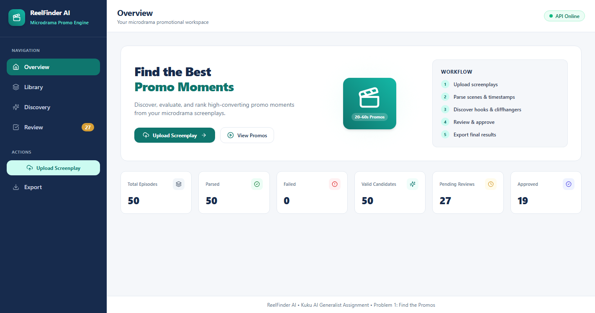
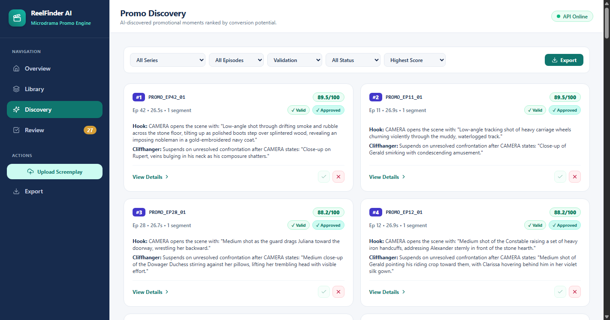
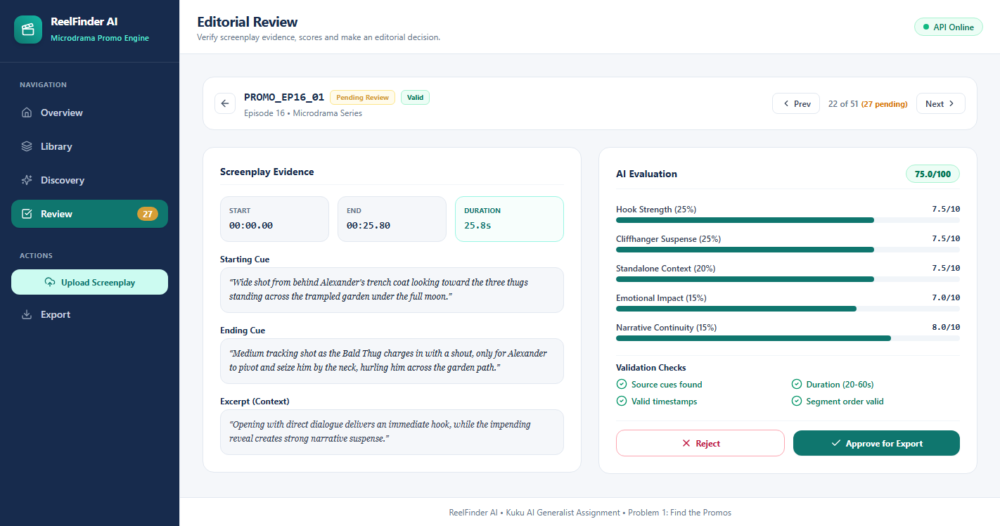
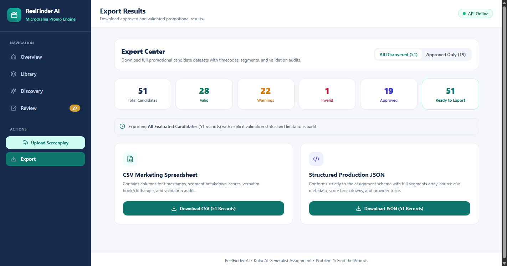

# ReelFinder AI

**AI-assisted promo discovery for microdrama screenplays.**

[](https://fastapi.tiangolo.com/)
[](https://reactjs.org/)
[](https://www.postgresql.org/)
[]()
[](https://reelfinder-frontend.onrender.com/)

> **Kuku AI Generalist Assignment | Problem 1: Find the Promos (Ads)**  
> ReelFinder AI analyzes microdrama screenplays to discover, validate, and rank high-converting 20–60 second promotional clips. It pairs AI narrative comprehension (Groq LPU and Google Gemini) with deterministic Python timestamp validation and a human-in-the-loop review station.

---

## 🌐 Live Prototype

- **Live Web Application (Frontend):** [https://reelfinder-frontend.onrender.com/](https://reelfinder-frontend.onrender.com/)
- **Live REST Backend (Health Check):** [https://reelfinder-backend.onrender.com/api/health](https://reelfinder-backend.onrender.com/api/health)
- **Interactive OpenAPI Documentation:** [https://reelfinder-backend.onrender.com/docs](https://reelfinder-backend.onrender.com/docs)

*Hosted on Render's free tier (FastAPI backend + React static site + PostgreSQL database).*

---

## 📸 Application Interface

### Overview Dashboard

*High-level workspace metrics: total episodes parsed, discovered candidate count, review progress, and system health status.*

### Ranked Discovery Feed

*AI-discovered promo candidates sorted by 0–100 composite conversion score, displaying duration, segment breakdown, opening hook, and cutoff cliffhanger.*

### Editorial Review Station

*Side-by-side verification: content editors inspect exact screenplay cues, 5-factor scoring breakdowns, and deterministic validation checks before 1-click approval.*

### Export Center

*Scope selector ("All Discovered" vs. "Approved Only") allowing instant download of production-ready CSV marketing spreadsheets and assignment-compliant JSON files.*

---

## 🎯 Problem & Objective

In fast-growing microdrama apps (Kuku TV, ReelShort, DramaBox), series are released as vertical 1-to-2 minute episodes, often spanning 50 to 100 episodes per show.

Customer acquisition on social platforms (TikTok, Instagram Reels, YouTube Shorts) relies heavily on short promotional video ads. These promos are exact narrative excerpts taken directly from the episodes.

Editors currently watch every episode manually to find these moments. However, finding a great promo is challenging:
1. **Dramatic does not mean promotional:** A scene might have great acting, but if it lacks an explosive hook in the first 3 seconds, a scrolling user swipes away immediately.
2. **The Cliffhanger matters most:** The clip must cut precisely at an unresolved peak of tension before the mystery is revealed or the conflict resolved, compelling the viewer to install the app.
3. **Standalone clarity:** An ad must make complete sense to a first-time viewer who has zero prior knowledge of the series.
4. **Strict duration limits:** Clips under 20 seconds fail to build narrative investment; clips over 60 seconds experience severe completion rate drop-offs in ad auctions.

**ReelFinder AI** automates this discovery process. It scans the screenplay text, finds suitable moments, verifies start/end timestamps against source cues, ranks candidates by conversion potential, and presents them to human editors for final sign-off.

---

## ⚙️ How It Works

```
1. Upload Screenplay (.txt / .pdf / .zip)
       │
       ▼
2. Parse Screenplay State Machine ───► Extracts scenes, dialogue, camera directions & normalized timestamps
       │
       ▼
3. Context Segmentation ────────────► Groups cues into valid 20–60s narrative windows
       │
       ▼
4. Multi-Tier AI Inference ─────────► Evaluates 3s hook, cliffhanger cutoff, standalone context & emotional stakes
       │                              (Tier 1: Groq LPU -> Tier 2: Gemini -> Tier 3: Heuristic Fallback)
       ▼
5. Deterministic Python Rules ──────► Validates 20–60s bounds, snaps approximate cues (<0.5s), rejects invented timestamps
       │
       ▼
6. Semantic Duplicate Detector ─────► Filters candidates sharing >=75% temporal overlap or repeated generic tropes
       │
       ▼
7. Composite 5-Factor Ranking ──────► Computes 0–100 composite score (Hook 25%, Cliffhanger 25%, Standalone 20%, Impact 15%, Continuity 15%)
       │
       ▼
8. Editorial Review & Export ───────► Human editor reviews evidence side-by-side, approves candidates, and exports CSV / JSON
```

---

## ⚖️ Division of Responsibility: AI vs. Deterministic Code

| Task | Handled by AI | Handled by Deterministic Code | Rationale |
|---|---|---|---|
| **Narrative Comprehension** | Evaluates emotional stakes, curiosity gaps, and dramatic tension. | Does not judge subjective literary quality. | LLMs excel at contextual language understanding. |
| **Timecodes & Bounds** | Proposes candidate start/end anchors. | **Strictly enforces:** $20.0\text{s} \le \text{duration} \le 60.0\text{s}$, $\text{start} < \text{end}$, and chronological segment ordering. | LLMs are fundamentally unreliable at boundary arithmetic. Python rules guarantee 100% compliance. |
| **Source Grounding** | Selects verbatim dialogue quotes. | Snaps approximate timecodes ($\le 0.5\text{s}$) to verified screenplay lines; rejects invented timestamps ($>1.0\text{s}$). | Prevents hallucinated timestamps from entering production editing pipelines. |
| **Deduplication** | Identifies narrative themes. | Computes Jaccard word similarity and temporal overlap ratios ($\ge 75\%$). | Algorithms reliably filter redundant candidates covering the same story beat. |
| **Composite Ranking** | Scores raw qualitative factors (1–10). | Computes normalized 0–100 weighted score and applies validation penalties. | Ensures transparent, explainable, and reproducible candidate rankings. |

---

## 🛠️ Technology Stack

- **Backend:** Python 3.11, FastAPI, Uvicorn, Pydantic v2
- **Persistence:** SQLAlchemy 2.0, PostgreSQL (production), SQLite (in-memory test suite)
- **AI Providers:**
  - *Primary:* Groq LPU Inference (`openai/gpt-oss-120b`, `qwen/qwen3.8-27b`) with automatic key rotation
  - *Secondary:* Google Gemini API (`gemini-3.8-flash`)
  - *Fallback:* Deterministic Heuristic Engine (`MockLLMProvider`)
- **Frontend:** React 19, Vite, Tailwind CSS, Lucide Icons, Axios
- **Screenplay Parsing:** Regex State Machine, `pypdf`
- **Testing & QA:** `pytest`, `pytest-asyncio`, Selenium WebDriver
- **Deployment:** Render Blueprint (`render.yaml`), Docker, Docker Compose

---

## 🚀 Local Setup & Quick Start

### 1. Prerequisites
- Python 3.10+
- Node.js 18+ and npm
- Git

### 2. Clone Repository
```bash
git clone https://github.com/nitin-code6/reelfinder-ai.git
cd reelfinder-ai
```

### 3. Backend Setup
```bash
cd backend
python -m venv venv

# Windows:
.\venv\Scripts\activate
# Linux/macOS:
source venv/bin/activate

pip install -r requirements.txt
cp ../.env.example .env
uvicorn app.main:app --reload --port 8000
```
*Backend API will be live at `http://localhost:8000` with interactive Swagger docs at `http://localhost:8000/docs`.*

### 4. Frontend Setup
```bash
cd ../frontend
npm install
npm run dev
```
*Frontend will be live at `http://localhost:5173` (or `http://localhost:3000` with Docker).*

### 5. Running with Docker Compose (Optional)
```bash
docker compose up --build
```
- Frontend: `http://localhost:3000`
- Backend API: `http://localhost:8000`
- PostgreSQL: `localhost:5432`

---

## 🧪 Testing & Verification

Run all 86 automated unit, integration, and evaluation tests:
```bash
pytest backend/tests -v
```

Run the reconciliation audit between database, JSON, and CSV exports:
```bash
python backend/scripts/reconcile_audit.py
```

Run batch evaluation over all 50 episodes:
```bash
python backend/scripts/run_batch_evaluation.py
```

---

## 📚 Technical Documentation Index

| Document | Purpose |
|---|---|
| [docs/ARCHITECTURE.md](docs/ARCHITECTURE.md) | High-level system architecture, component boundaries, database schemas, and dataflow diagrams. |
| [docs/APPROACH.md](docs/APPROACH.md) | Problem-solving methodology, viral selection mechanics, 5-factor scoring formula, and multi-segment logic. |
| [docs/QUALITY_AND_TESTING.md](docs/QUALITY_AND_TESTING.md) | Test suite breakdown (86 tests), failure analysis, real debugging case studies, and synthetic vs. real runs. |
| [docs/LIMITATIONS.md](docs/LIMITATIONS.md) | Honest assessment of system limitations, screenplay vs. footage constraints, and scalability roadmap. |
| [docs/AI_USAGE.md](docs/AI_USAGE.md) | Transparent disclosure of AI tools used, operational scope, and two concrete AI failures resolved. |
| [docs/KUKU_SOLUTION_DOCUMENT.md](docs/KUKU_SOLUTION_DOCUMENT.md) | Executive 2-page solution brief covering problem framing, architecture, quality, and economics. |

---

## 🔒 Confidentiality Notice
The original 50-episode screenplay dataset (*I Married a Broken Soldier. He was a Duke*) provided in the Kuku FM input pack is proprietary and strictly excluded from public version control via `.gitignore`. The repository includes synthetic screenplay fixtures (`backend/tests/fixtures/`) for automated testing and CI.
